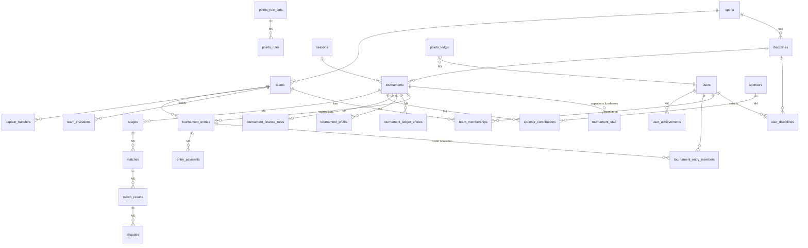

# Database design (PostgreSQL)

Conventions
- `bigint` identity primary keys, `timestamptz` timestamps (stored in UTC; the app converts to local time for display).
- Money: `*_minor bigint` plus `currency char(3)`. **No floats.**
- Status columns are `varchar` backed by PHP enums plus a database `CHECK` constraint (Postgres).
- `is_sample_data boolean` on user-facing tables seeded for development, so the admin panel can label and purge them.
- Append-only tables (`audit_logs`, `points_ledger`, `tournament_ledger_entries`) have no update or delete paths in the code.
- **Milestone** shows when each table is implemented. ✅ = migration exists in this repository.

## Entity–relationship overview

## Milestone 2: identity, roles, catalog, profiles

| Table | Key columns | Constraints and indexes |
|---|---|---|
| ✅ `users` | `username`, `email`, `password`, `email_verified_at`, `display_name`, `avatar_path`, `city`, `locale`, `phone` (private), `privacy` jsonb, `notification_preferences` jsonb, `status` (active/suspended/pending_deletion/deleted), `deletion_requested_at`, `deletion_scheduled_for`, `last_login_at`, `is_sample_data` | unique lower(`username`), unique lower(`email`), CHECK status |
| ✅ `personal_access_tokens` | Sanctum, one row per device | index tokenable |
| ✅ `password_reset_tokens`, `sessions` | Laravel defaults | |
| ✅ `roles`, `permissions`, `model_has_roles`, `model_has_permissions`, `role_has_permissions` | spatie/laravel-permission | |
| ✅ `sports` | `slug`, `name`, `name_translations` jsonb, `icon`, `kind` (physical/esport), `sort_order`, `is_active` | unique slug |
| ✅ `disciplines` | `sport_id`, `slug`, `name`, `name_translations`, `registration_types` jsonb (individual/pair/team), `team_size_min/max`, `substitutes_max`, e-sports: `game_title`, `game_version`, `platform`, `region`, `match_format`, `competition_mode` (local/online/lan), `ruleset_status` (confirmed/needs_confirmation), `ruleset_notes`, `is_active` | unique (`sport_id`,`slug`), CHECK sizes |
| ✅ `user_disciplines` | `user_id`, `discipline_id` | PK (user, discipline) |
| ✅ `feature_flags` | `key`, `enabled`, `description`, `updated_by`, `reason` | unique key |
| ✅ `audit_logs` | `actor_id`, `action`, `subject_type`, `subject_id`, `old_values`, `new_values`, `reason`, `ip_address`, `user_agent`, `created_at` | index subject, index actor, append-only |
| ✅ `account_deletion_requests` | `user_id`, `requested_at`, `scheduled_for`, `cancelled_at`, `completed_at`, `reason` | |

## Milestone 3: teams, tournaments, registration

| Table | Key columns | Constraints and indexes |
|---|---|---|
| ✅ `teams` | `sport_id`, `name`, `slug`, `logo_path`, `captain_id`, `status` (active/disbanded), `is_sample_data` | unique slug, unique (sport_id, lower(name)) |
| ✅ `team_memberships` | `team_id`, `user_id`, `role` (captain/member/substitute), `status` (active/left/removed), `joined_at`, `left_at`, `left_reason` | **partial unique (team_id,user_id) WHERE status='active'**. Rows are never deleted, which gives membership history. |
| ✅ `team_invitations` | `team_id`, `invited_user_id`, `invited_by_id`, `role`, `status` (pending/accepted/declined/revoked/expired), `expires_at`, `responded_at` | partial unique (team_id, invited_user_id) WHERE status='pending' |
| ✅ `captain_transfers` | `team_id`, `from_user_id`, `to_user_id`, `status` (pending/accepted/declined/cancelled/forced), `reason`, `responded_at` | partial unique (team_id) WHERE status='pending' |
| ✅ `seasons` | `name`, `starts_on`, `ends_on`, `status` (draft/active/closed) | |
| ✅ `tournaments` | `slug`, `name`, `cover_path`, `sport_id`, `discipline_id`, `season_id`, `description`, `registration_type`, `eligibility_notes`, `min_entrants`, `max_entrants`, `roster_min`, `roster_max`, `substitutes_max`, `registration_opens_at`, `registration_closes_at`, `check_in_closes_at`, `starts_at`, `ends_at`, `timezone`, `venue_name`, `venue_address`, `city`, `online_region`, `lobby_details` (staff + checked-in only), `rules`, `format`, `third_place_method`, `prize_rules`, `funding_model`, `entry_fee_minor`, `currency`, `ranking_eligible`, `points_rule_set_id` (M5), `points_rules_locked_at`, `financial_rules_locked_at`, `status`, `published_at`, `cancellation_reason`, `created_by_id`, `is_sample_data` | CHECK `min_entrants <= max_entrants`, CHECK `entry_fee_minor >= 0`, CHECK status, CHECK date order, index (status, starts_at), index discipline |
| ✅ `tournament_staff` | `tournament_id`, `user_id`, `role` (organizer/referee) | unique (tournament, user, role) |
| ✅ `tournament_entries` | `tournament_id`, `entry_type`, `team_id`, `display_name`, `registered_by_id`, `registration_status` (reserved/waitlisted/cancelled/withdrawn/rejected/no_show), `payment_status` (not_required/unpaid/paid/refunded/partially_refunded), `check_in_status` (not_checked_in/checked_in), `eligibility_status` (pending/eligible/ineligible), `waitlist_position`, `reserved_at`, `cancelled_at`, `cancellation_reason`, `roster_locked_at`, `seed` | partial unique (tournament_id, team_id) WHERE active and team_id is not null; index (tournament_id, registration_status) |
| ✅ `tournament_entry_members` | `tournament_entry_id`, `tournament_id` (denormalized), `user_id`, `role` (captain/player/substitute), `username_snapshot`, `display_name_snapshot`, `is_active`, `removed_at` | **partial unique (tournament_id, user_id) WHERE is_active**, which blocks conflicting registrations at the database level |

Capacity: `RegistrationService::register()` runs in a transaction, locks the tournament row (`SELECT … FOR UPDATE`), counts `reserved` entries and places the new entry as `reserved` or `waitlisted`. Cancelling a reserved entry promotes the first waitlisted entry in the same transaction.

## Milestone 4: check-in, cash payments, finance
- ✅ `tournament_entries` adds `checked_in_at`, `checked_in_by_id`, `checked_in_member_id` (whose QR was scanned), `eligibility_reason` (staff decision).
- ✅ `entry_payments` (append-only): `tournament_entry_id`, `tournament_id`, `kind` (payment/refund), `method` (cash), `amount_minor` > 0, `currency`, `reference` (unique receipt number, RV-/RF-{tournament}-{seq}), `note`, `recorded_by_id`, `recorded_at`, `voided_at`, `voided_by_id`, `void_reason`. **Partial unique: one non-voided payment per entry.**

- ✅ `sponsors`: `name`, `slug`, `logo_path`, `website_url`, `description`, private `contact_name/email/phone`, `is_public` (display consent), `status`, `is_sample_data`.
- ✅ `sponsor_contributions`: `sponsor_id`, `tournament_id`, `type` (cash/in_kind/venue), `restriction` (unrestricted/prize_only/expenses_only, cash only), `committed_minor`, `currency`, `in_kind_description`, `status` (pledged/partially_received/received/cancelled; derived from ledger receipts), `cancel_reason`, `created_by_id`. Received cash is **not** a column: it is the sum of the contribution's ledger rows.
- ✅ `tournament_finance_rules` (one per tournament): `prize_pool_bp`, `organizer_share_bp` (basis points of net entry revenue; NULL = undecided), `status` (draft/approved), `approved_by_id`, `approved_at`, `approval_note`, `notes`. CHECK shares ≤ 100%.
- ✅ `tournament_prizes`: `place` (unique per tournament), `title`, `basis` (fixed/pool_share), `amount_minor`, `pool_share_bp`, `in_kind_description`, `label` (estimated/finalized/guaranteed), `backing_contribution_id`.
- ✅ `tournament_ledger_entries` (append-only): `type` (entry_revenue/refund/sponsor_cash/venue_expense/referee_expense/other_expense/allocation/organizer_payout/prize_payout/reversal), `fund` (unrestricted/prize/expense/organizer), signed `amount_minor` (≠ 0), `currency`, unique `reference`, **unique `entry_payment_id`** (one row per venue receipt), `sponsor_contribution_id`, `prize_id`, **unique `reverses_id`** (each row reversed at most once), `transfer_group` (allocation pairs), `payee`, `note`, `recorded_by_id`, `recorded_at`. The migration backfills rows for receipts recorded before M4B.

## Milestone 5: competition, results, points
- ✅ `stages`: `tournament_id`, `type` (single_elimination/round_robin/groups/knockout), `name`, `sequence` (unique per tournament), `status` (draft/published/completed), `settings` json (draw_seed, table_points, group_size, advance_per_group, third_place_match).
- ✅ `stage_groups`: `stage_id`, `name` (A, B…), `sequence`.
- ✅ `matches`: `tournament_id`, `stage_id`, `stage_group_id`, `round`, `position`, `label`, `status` (pending/ready/completed/cancelled/bye), `scheduled_at`, `location`, `next_match_id` + `next_slot`, `loser_next_match_id` + `loser_next_slot` (third-place match), `winner_entry_id`, `is_draw`, `approved_result_id`.
- ✅ `match_participants`: `match_id`, `slot` (1/2, unique per match), `tournament_entry_id` (null = to be decided or bye).
- ✅ `match_results` (versioned): `match_id`, `version` (unique per match), `outcome` (normal/walkover/forfeit/no_show/disqualification/cancelled), `scores` json (`slot1`, `slot2`, optional `sets`), `winner_slot` (null = draw/cancelled), `status` (submitted/approved/rejected/superseded), `submitted_by_id`, `submitted_as` (participant/staff), `note`, `reviewed_by_id`, `reviewed_at`, `review_note`. **Partial unique: one approved result per match.**
- ✅ `result_disputes`: `match_result_id`, `match_id`, `tournament_entry_id`, `raised_by_id`, `reason`, `status` (open/upheld/rejected), `resolved_by_id`, `resolved_at`, `resolution_note`.
- ✅ `points_rule_sets`: `name`, `discipline_id`, `season_id` (null = all seasons), `version`, `status` (draft/published/retired), `notes`, `published_by_id`, `published_at`, `publish_note`. Published sets are immutable.
- ✅ `points_rules`: `points_rule_set_id`, `trigger` (participation/match_win/match_draw/match_loss/place_1/place_2/place_3, unique per set), `points` (≥ 0), `eligible_outcomes` json (match triggers).
- ✅ `points_ledger` (append-only): `user_id`, `tournament_id`, `tournament_entry_id`, `discipline_id`, `season_id`, `points_rule_set_id`, `rule_set_version`, `points_rule_id`, `match_result_id`, `award_type`, `points_delta` (≠ 0), `reason`, **unique `idempotency_key`**, **unique `reverses_id`**, `created_by_id`, `created_at`.
- ✅ `tournament_entries.final_place`, `tournaments.placements_finalized_at`; `tournaments.points_rule_set_id` and `points_rules_locked_at` are now used.
- Planned: `result_evidence` (private disk), team leaderboards, `leaderboard_snapshots`.

## News (delivered early)
- ✅ `news_articles`: `slug` unique, `title`, `summary`, `body` (plain text, blank line = paragraph), `cover_path` (public disk), `category` (announcement/tournament/results/community/guide), `locale` (NULL = every app language, or en/ar/kmr), `sport_id`, `tournament_id` (shown only while the tournament is public), `is_featured` (photo slider), `status` (draft/published/archived), `published_at` (future = scheduled), `author_id` (never exposed by the API), `is_sample_data`. Index (status, published_at), (is_featured, published_at). Published articles can't be deleted, only archived.

## Milestone 6: badges, inbox, announcements, push
- ✅ `achievements`: unique `key`, `name` + `name_translations`, `description` + `description_translations`, `icon`, `criteria_type` (matches_played/matches_won/tournaments_completed/podium_finishes/tournament_wins/check_ins/manual), `threshold`, `sort_order`, `status` (draft/active/retired).
- ✅ `user_achievements`: `user_id`, `achievement_id` (unique pair), `source` (auto/manual), `awarded_by_id`, `reason`, `context`, `awarded_at`, `revoked_at`, `revoked_by_id`, `revoke_reason`.
- ✅ `user_notifications` (inbox): `user_id`, `type`, `category` (preference key controlling push), `title`, `body` (rendered in the user's language), `link_kind`, `link_ref`, `data`, **unique (`user_id`, `dedupe_key`)**, `read_at`, `push_status` (queued/sent/skipped_preference/no_device/failed), `pushed_at`, `announcement_id`.
- ✅ `announcements`: `title`, `body`, `category`, `audience` (everyone/discipline/tournament_entrants), `audience_ref`, `locale`, `link_kind`, `link_ref`, `send_push`, `status` (draft/scheduled/sending/sent/cancelled), `send_at`, `sent_at`, `recipients_count`, `created_by_id`, `sent_by_id`, `is_sample_data`.
- ✅ `device_tokens`: `user_id`, `personal_access_token_id` (cascade: signing out removes the push token), unique `token` (never returned by any API), `platform` (ios/android/web), `app_version`, `last_seen_at`.

## Milestone 7: reports, blocking, policy pages
- ✅ `reports`: `reporter_id`, `subject_type` (user/team/app), `subject_user_id`, `subject_team_id`, `dedupe_key` ("user:12"; **partial unique (`reporter_id`, `dedupe_key`) WHERE status = 'open'**: one open report per reporter and subject), `reason`, `details`, `snapshot` (public profile/team fields at report time; scrubbed when the reported account is deleted), `context` (app reports: app version, platform, language), `status` (open/actioned/dismissed), `action` (remove_photo/reset_display_name/rename_team/warn/suspend/resolved), `resolution_note` (internal), `handled_by_id`, `handled_at`. The reporter is never exposed to the reported player.
- ✅ `user_blocks`: `blocker_id`, `blocked_id`, unique pair (pgsql: CHECK not self). Private to the blocker.
- ✅ `pages`: `slug` (terms/privacy/community-guidelines), draft `title_translations` and `body_translations` (en/ar/kmr), `requires_legal_review`, `current_version` (0 = never published), `published_at`, `legal_reviewed_version`, `legal_reviewed_at`, `legal_reviewer`, `legal_review_note`, `legal_recorded_by_id`. A legal review counts only for the version it was recorded for.
- ✅ `page_versions` (append-only): `page_id`, `version` (unique per page), `title_translations`, `body_translations`, `change_note`, `published_by_id`, `published_at`.

## Milestone 8: official store
All money in integer minor units of one store currency (`RIVALO_STORE_CURRENCY`, default IQD).
- ✅ `products`: unique `slug`, `name_translations`, `description_translations` (en/ar/kmr), `category` (jerseys/apparel/accessories/equipment), `sport_id`, `price_minor`, `currency`, `status` (draft/active/archived), `is_featured`, `sort_order`, `max_per_order`, `is_sample_data`. Ordered products can't be deleted (archive them).
- ✅ `product_images`: `product_id`, `path` (public disk, re-encoded on upload), `alt`, `sort_order`.
- ✅ `product_variants`: `product_id`, unique `sku`, `option_label` (size or option), `price_minor` (NULL = product price), **`stock`** (running balance of the movement ledger, changed only under a row lock; pgsql CHECK ≥ 0), `is_active`, `sort_order`.
- ✅ `inventory_movements` (append-only): `product_variant_id`, `quantity_delta` (≠ 0), `reason` (restock/adjustment/order/order_cancelled/return), `order_id`, `note`, `created_by_id`, `created_at`. `stock` = SUM(`quantity_delta`) (tested).
- ✅ `pickup_locations`: `name`, `address`, `opening_hours`, `is_active`. ✅ `delivery_zones`: `name`, `fee_minor`, `estimate`, `is_active` (no active zone = no delivery).
- ✅ `cart_items` (the bag): `user_id`, `product_variant_id` (unique pair), `quantity`. No prices stored: the bag always shows today's price.
- ✅ `orders`: unique `number` (ORD-000042), `user_id`, `status` (placed/confirmed/ready/out_for_delivery/completed/cancelled), `fulfillment` (pickup/delivery), `pickup_location_id`, `delivery_zone_id`, private `recipient_name`/`recipient_phone`/`delivery_address`, `customer_note`, `currency`, `subtotal_minor`, `delivery_fee_minor`, `total_minor` (pgsql CHECK = subtotal + fee), `payment_method` (cash_on_pickup/cash_on_delivery), `payment_status` (unpaid/paid/refunded/partially_refunded), `amount_paid_minor`, `amount_refunded_minor`, unique `payment_reference` (SR-000042), `paid_at`, `paid_recorded_by_id`, lifecycle timestamps, `cancel_reason`, `cancelled_by` (customer/staff), `is_sample_data`.
- ✅ `order_items`: snapshot of `product_name`, `option_label`, `sku`, `unit_price_minor`, `quantity`, `line_total_minor`, plus `returned_quantity`.

## Milestone 9: approved sellers
Model (decision D22): sellers bring stock to RIVALO, which sells it through the M8 store; sellers are paid from an append-only statement.
- ✅ `sellers`: `user_id` (unique: one shop per account), unique `slug`, public `name`, `bio_translations`, `logo_path` (re-encoded); private `contact_phone`, `contact_email`, `business_address`; `status` (active/suspended/closed, pgsql CHECK) with `status_reason`; `commission_bps` (from the signed agreement, no default, pgsql CHECK ≤ 10000), `agreement_reference`, `verification_note` (what staff checked; no ID documents are stored), `approved_by_id`, `approved_at`, `is_sample_data`. Never deleted.
- ✅ `seller_applications`: `user_id`, `business_name`, `contact_phone`, `city`, `categories`, `description`, `link`, `status` (pending/approved/rejected/withdrawn), `decision_note` (shown to the applicant when rejected), `reviewed_by_id`, `reviewed_at`, `seller_id`. Partial unique index: one pending application per person. Deleted when the account is anonymised.
- ✅ `products` + `seller_id` (NULL = official), `review_note`, `submitted_at`, `reviewed_at`, `reviewed_by_id`; statuses draft / pending_review / changes_requested / active / archived.
- ✅ `order_items` + `seller_id` and `commission_bps`, copied at checkout (later commission changes never touch past orders).
- ✅ `seller_ledger_entries` (append-only, model refuses updates and deletes): `seller_id`, `type` (sale/return/adjustment/payout), `currency`, `gross_minor`, `commission_minor`, `amount_minor` (what RIVALO owes; payouts negative, pgsql CHECK), `order_id`, `order_item_id`, `quantity`, `payout_method` (cash/bank_transfer/other), `reference`, `note`, unique `idempotency_key` (`sale:{item}`, `return:{item}:{n}`, `payout:{uuid}`), `created_by_id`, `occurred_at`. Balance = SUM(`amount_minor`) per currency.
- ✅ `inventory_movements.reason` + `returned_to_seller`.
